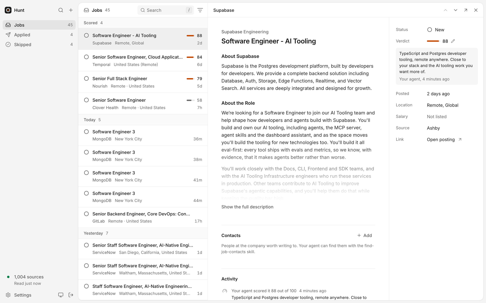
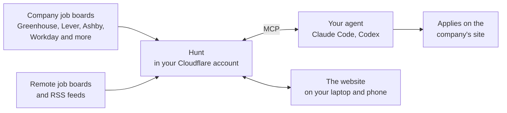
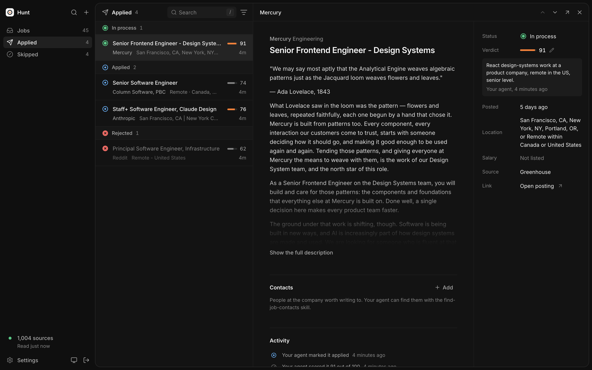
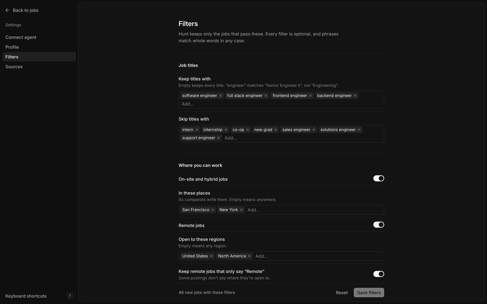
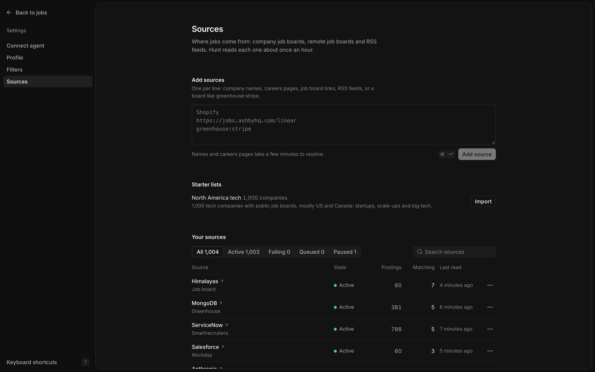
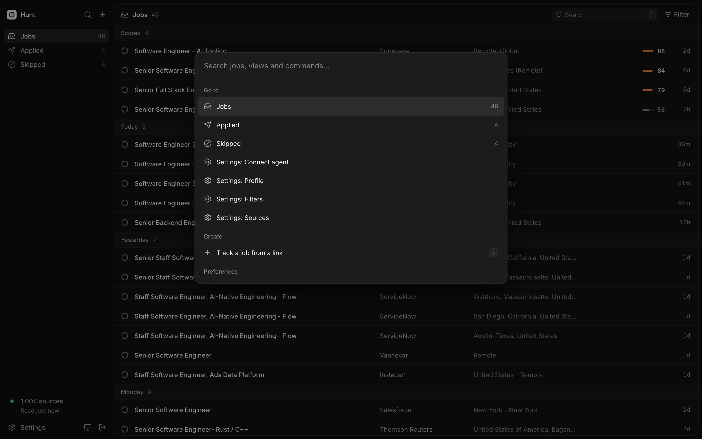
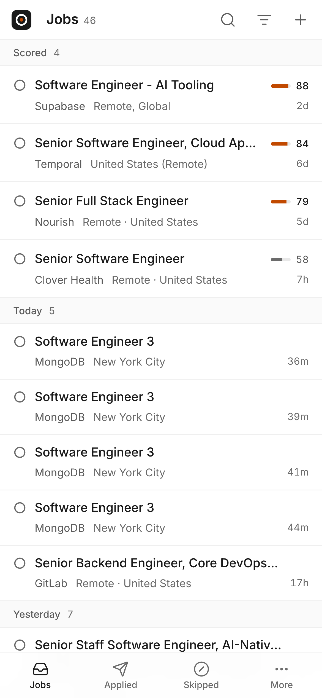
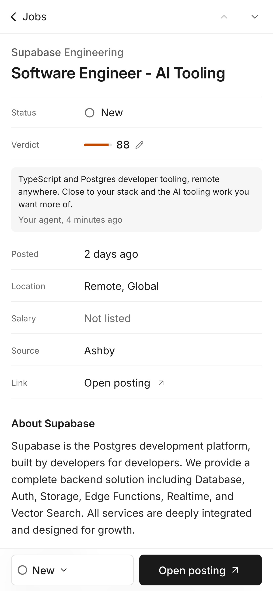
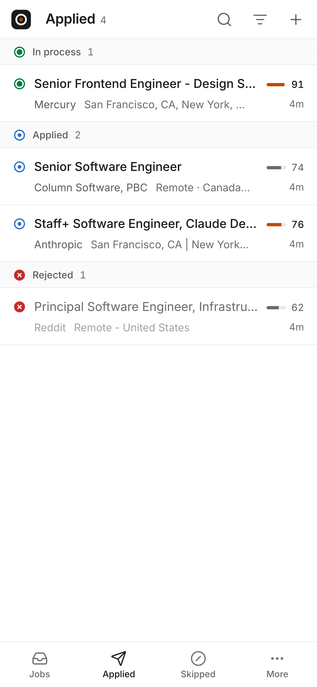

<div align="center">


# Hunt

**Self-hosted AI job search for Claude Code, Codex and any MCP agent.**

Hunt collects new postings from the job boards of the companies you pick, keeps the ones that pass your filters, and tracks every application. Your agent reads the new jobs over MCP, judges the fit against your resume, applies, and records what happened. It runs in your own Cloudflare account, on the free plan.

[](https://deploy.workers.cloudflare.com/?url=https://github.com/meetshukla/JobSearch-MCP)

</div>

<br>

<picture>
  <source media="(prefers-color-scheme: dark)" srcset="docs/images/jobs-dark.png">
  
</picture>

## What it does

Hunt reads companies' own job boards, the Greenhouse, Lever, Ashby and Workday pages behind their careers sites. A posting reaches you about an hour after it goes up, straight from the company, with its full description.

The app does the steady work and your agent does the thinking. There is no AI inside and no API key to pay for.

| | Hunt | Your agent |
|---|---|---|
| Find | Reads company job boards, remote job boards and RSS feeds, each about once an hour | Picks the companies and boards that fit you |
| Filter | Keeps jobs that pass your filters: titles, places, remote regions, how recent, words to skip | Sets the filters with you |
| Judge | | Reads each new job against your profile and writes a fit score with a one-line reason |
| Apply | | Writes the tailored resume and applies on the company's site |
| Track | Status, notes, contacts and a timeline for every job | Records each step as it goes |



## Get started

You need a Cloudflare account (the free plan is enough) and an agent that speaks MCP.

### 1. Deploy

Click **Deploy to Cloudflare** above. Cloudflare copies this repo to your GitHub, builds it, and asks for `HUNT_TOKEN`. The token is a long random password, and `openssl rand -hex 24` makes a good one. Keep it in your password manager.

Or deploy from your terminal with Node 22.18 or later:

```bash
git clone https://github.com/meetshukla/JobSearch-MCP hunt
cd hunt
npm install
npx wrangler login
npm run deploy                              # prints https://hunt.<you>.workers.dev
openssl rand -hex 24                        # your token
npx wrangler secret put HUNT_TOKEN          # paste the token
```

Open the URL and sign in with the token. To use your own domain, run `npm run build && npx wrangler deploy --domain jobs.example.com`.

### 2. Connect your agent

The MCP server is `<your url>/mcp`. It takes your token as a bearer token. Put the token in your shell profile first:

```bash
export HUNT_TOKEN=...
```

Then add the server to your agent.

```bash
# Claude Code
claude mcp add --transport http hunt https://hunt.<you>.workers.dev/mcp \
  --header "Authorization: Bearer $HUNT_TOKEN"

# Codex
codex mcp add hunt --url https://hunt.<you>.workers.dev/mcp \
  --bearer-token-env-var HUNT_TOKEN
```

Other clients take this JSON:

```json
{
  "mcpServers": {
    "hunt": {
      "type": "http",
      "url": "https://hunt.<you>.workers.dev/mcp",
      "headers": { "Authorization": "Bearer ${HUNT_TOKEN}" }
    }
  }
}
```

The website's **Settings > Connect agent** page shows the same commands with your URL filled in.

### 3. Set it up with your agent

Open your agent in this repo and ask:

> Read AGENTS.md and set up Hunt for me.

[AGENTS.md](AGENTS.md) walks the agent through the setup. It asks for your resume, where you can work, the titles you want and your deal-breakers. Then it saves your profile, sets the filters and picks the companies to follow. The first jobs arrive within the hour.

You can also do it yourself on the website, under **Settings**.

## Use it every day

Talk to your agent the way you would to a friend who helps with your search.

| You say | Your agent |
|---|---|
| "Review my new jobs." | Reads the jobs it hasn't scored yet, gives each a fit score and a reason, and skips the ones that don't fit |
| "Which ones should I apply to this week?" | Lists the best-scored open jobs with the reasons |
| "Apply to the Supabase one with a tailored resume." | Checks the posting is still open, writes the resume, applies, and marks the job **Applied** |
| "Who should I write to about it?" | Finds the hiring manager and recruiter with the [`find-job-contacts`](skills/find-job-contacts/SKILL.md) skill and saves them on the job |
| "Reddit rejected me." | Moves the job to **Rejected** |

Your agent reads only the **Jobs** view, which holds new jobs. Anything you applied to or skipped leaves it, and `unscored_only` hides the jobs your agent already scored, so it reads each job once.

## The website

The website shows what your agent sees, and you can do everything there too. It has three views.

| View | Holds |
|---|---|
| **Jobs** | New jobs that pass your filters. Scored jobs first, then by the day they were posted. |
| **Applied** | Jobs you applied to, grouped by **In process**, **Applied** and **Rejected** |
| **Skipped** | Jobs you or your agent passed on |

<table>
  <tr>
    <td width="50%"></td>
    <td width="50%"></td>
  </tr>
  <tr>
    <td><b>Applied.</b> Every job you applied to, by stage, with how long ago it last moved.</td>
    <td><b>Filters.</b> Every filter is optional. The preview counts how many jobs a change would show before you save it.</td>
  </tr>
  <tr>
    <td></td>
    <td></td>
  </tr>
  <tr>
    <td><b>Sources.</b> The companies and boards Hunt reads, how many postings each has, how many pass your filters, and when each was last read.</td>
    <td><b>Command menu.</b> Press <kbd>⌘</kbd> <kbd>K</kbd> to jump to any job, change a status, track a link or add a source.</td>
  </tr>
</table>

It works on your phone as well.

<p align="center">
  
  &nbsp;
  
  &nbsp;
  
</p>

Keyboard shortcuts cover everything. Press <kbd>?</kbd> in the app for the list. The most used are <kbd>j</kbd> and <kbd>k</kbd> to move through jobs, <kbd>s</kbd> to change a status, <kbd>o</kbd> to open the posting and <kbd>/</kbd> to search.

## Tools

The MCP server has nine tools. The website calls the same ones, so you and your agent always see the same data. The definitions are in [`server/tools.ts`](server/tools.ts).

| Tool | What it does |
|---|---|
| `get_settings` | Returns your profile, your filters and what setup still needs |
| `update_settings` | Saves your profile (resume and what you want, as plain text) and your filters. With `preview`, it counts the jobs a filter change would show. |
| `add_sources` | Adds company names, careers pages, job board URLs, RSS feeds or a starter list |
| `list_sources` | Lists sources with their state, errors and last read time |
| `update_sources` | Pauses, resumes, removes or re-reads sources |
| `list_jobs` | Lists one view (`jobs`, `applied` or `skipped`) as short rows. `unscored_only` returns the jobs your agent hasn't judged yet. |
| `get_job` | Returns one job with its full description, contacts and timeline |
| `add_job` | Tracks any job from a link, whatever your filters say |
| `update_job` | Sets the fit score and reason, the status, a note or contacts |

A job's status is one of `new`, `skipped`, `applied`, `in_process` and `rejected`.

## Sources

- **Company job boards.** Greenhouse, Lever, Ashby, SmartRecruiters, Workable, Recruitee and Workday. Add a company by name and Hunt finds its board, or paste its careers page or board URL.
- **Remote job boards.** Remotive, Himalayas, Jobicy, We Work Remotely and Arbeitnow, on by default. Remove the ones you don't want.
- **RSS and Atom feeds** of job postings.
- **One job at a time** from any posting page with schema.org job data, through `add_job`.
- **A starter list** of 1,000 tech companies with public job boards, mostly in the US and Canada, in [`lists/north-america-tech.json`](lists/north-america-tech.json). It is optional.

LinkedIn and Indeed have no public job feeds, so Hunt doesn't read them. Most companies that post there also post on their own board, which Hunt reads. For the rest, give your agent the link and it tracks the job with `add_job`.

## Filters

Hunt has opinions, and every one of them is a setting you can change or turn off.

| Filter | Default |
|---|---|
| Titles to keep | software engineer, software developer |
| Titles to skip | intern, internship, co-op, new grad, sales engineer, solutions engineer, support engineer |
| On-site and hybrid places | Anywhere |
| Remote regions | Any region |
| Remote jobs that don't say where | Kept |
| Posted within | 7 days |
| Jobs with no posting date | Hidden |
| Words in the description that rule a job out | None |
| Companies to skip | None |

Phrases match whole words in any case, so "engineer" doesn't match "engineering". [AGENTS.md](AGENTS.md#5-set-the-filters) explains each filter for your agent.

## Skills

Two optional skills in [`skills/`](skills) give your agent a routine. Copy a folder into your agent's skills folder, for example `~/.claude/skills/`.

- [`review-jobs`](skills/review-jobs/SKILL.md) scores new jobs against your profile the same way every day and brings the best ones to you.
- [`find-job-contacts`](skills/find-job-contacts/SKILL.md) finds the hiring managers and recruiters for a job, with LinkedIn links and verified emails, and saves them on the job. It uses [treg](https://treg.to/llms.txt) by default, and any people-data provider works.

## Limits and cost

Hunt runs on Cloudflare's free plan, so it costs nothing. One Worker and one Durable Object hold everything, with your data in the Durable Object's SQLite database.

The free plan allows 50 outside requests per run. Hunt works in small steps every 15 seconds: four company boards, one remote board or feed, and six job descriptions per step. That reads about 1,000 company boards an hour. With more boards, a full pass takes longer.

## FAQ

**Does it apply to jobs for me?**
No. Your agent applies, in its own browser, after you agree. Hunt keeps the list and the record.

**Does it need an OpenAI or Anthropic key?**
No. Hunt runs no AI model. Your agent judges the fit with its own model.

**Where is my data?**
In your Cloudflare account, in one SQLite database. Nothing goes anywhere else.

**Can several people share one deployment?**
No. A deployment is for one person: one profile, one token. Each person deploys their own, which is free.

**Does it work outside North America?**
Yes. Places and remote regions are free text, and you choose the companies. The starter list is the only part that leans North American, and a list for your region is a welcome pull request.

## Develop

```bash
npm run dev                                          # http://localhost:8787, no sign-in
node scripts/mcp.ts http://localhost:8787            # list the tools
node scripts/mcp.ts http://localhost:8787 list_jobs  # call one
npm test                                             # filter tests
npm run typecheck
```

| Path | Holds |
|---|---|
| `server/filters.ts` | The filter, one pure function used when collecting and when listing |
| `server/lib/collect.ts` | The collector that runs every 15 seconds |
| `server/lib/sources.ts` | Adding and resolving sources |
| `server/lib/jobs.ts` | Views, one job, and tracking |
| `server/sources/` | Readers for each job board system, remote board and RSS |
| `server/tools.ts`, `server/mcp.ts` | The tools and the MCP server |
| `shared/types.ts` | Shapes shared by the server and the website |
| `client/` | The website, in React. [`client/DESIGN.md`](client/DESIGN.md) has its design rules. |
| `worker/` | The Cloudflare Worker and the Durable Object |

## Contributing

Pull requests are welcome. These help the most:

- **A new job board system** such as Personio, Teamtailor or BambooHR. Add an adapter in [`server/sources/ats.ts`](server/sources/ats.ts) and its URL pattern in `parseAtsUrl`.
- **A starter list for your region.** Add a JSON file in [`lists/`](lists) and one line in [`server/lib/lists.ts`](server/lib/lists.ts).
- **A remote job board.** Add it in [`server/sources/boards.ts`](server/sources/boards.ts).

## License

[MIT](LICENSE)
